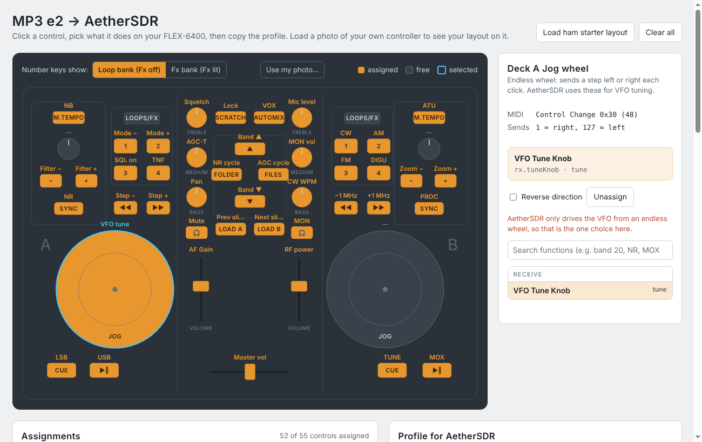

# MP3e2 to AetherSDR

Control a FlexRadio (tested with a FLEX-6400) from a **Hercules DJControl MP3 e2** in
[AetherSDR](https://github.com/aethersdr/AetherSDR), the open-source cross-platform FlexRadio
client. The MP3 LE and Glow have the same controls and work the same way.

The idea comes from KE9NS, who mapped this controller for PowerSDR. This project does the same
for AetherSDR and adds a way to set it up by clicking the controls on a picture.

## What's here

| Folder | What it is | Needs |
|---|---|---|
| [`profiles/`](profiles/) | A ready AetherSDR MIDI profile: VFO on the left jog wheel, receive on Deck A, transmit on Deck B. | Any current AetherSDR |
| [`web-mapper/`](web-mapper/) | A page that runs in your browser: click a control, pick its AetherSDR function, copy the profile. | A web browser |
| [`aethersdr-patch/`](aethersdr-patch/) | A **Visual Mapper** window built into AetherSDR itself: the same click-to-map picture, with changes applied live. | Building AetherSDR from source |
| [`docs/`](docs/) | MIDI map, design notes, build guide and project log. | |

## Quick start: use the profile

1. **Driver:** install the Hercules driver for the DJControl MP3 e2. This controller is not a
   class-compliant MIDI device, so without it no MIDI port appears. On Windows and macOS, use
   Hercules' support page; on Linux it needs Hercules' kernel module or user-mode driver.
2. **Connect:** start AetherSDR and open **Settings → Controllers → MIDI Mapping**. Pick the
   Hercules in **Port** and click **Connect**. This is easy to miss; nothing works until the
   port is connected.
3. **Import:** click **Import…** and choose `profiles/Hercules MP3 e2.xml`.
4. **Load:** Import only stores the profile. Pick it in the **Profile** list and click
   **Load**. The bindings table fills with 52 rows.
5. **Test:** turn the left jog wheel. The VFO tunes.

AetherSDR remembers the port and the bindings, so next time just plug in and start it.

The starter layout, control by control, is in [docs/MIDI-MAP.md](docs/MIDI-MAP.md). In short:

| Area | Starter profile |
|---|---|
| Deck A jog wheel | VFO tuning |
| Deck A faders and knobs | AF gain, squelch, AGC threshold, audio pan |
| Deck A buttons | NB, NR, filter narrow/widen, tune step −/+, LSB, USB, mute, mode −/+, squelch on/off, TNF, NR2, RN2, band zoom, segment zoom |
| Centre | Band ▲ / Band ▼ on the arrows, previous/next slice on Load A/B, NR and AGC cycle, tune lock, VOX, master volume on the crossfader |
| Deck B faders and knobs | RF power, mic level, monitor volume, CW speed |
| Deck B buttons | MOX on Play, TUNE on Cue, ATU, PROC, monitor, CW / AM / FM / DIGU, ANF, RIT, XIT, split, pan zoom, ±1 MHz |

MOX latches: one press transmits and the next press stops. For hold-to-talk, bind **PTT (hold
to talk)** instead.

## Make your own layout: web mapper

Open [`web-mapper/index.html`](web-mapper/index.html) in a browser (download it, then
double-click). Click any knob, fader, wheel or button and pick its function; the list only
offers functions that control can drive. Then click **Copy profile XML**, save the text as
`Hercules MP3 e2.xml`, and do **Import…** and **Load** in AetherSDR.

- **Your photo:** **Use my photo…** puts a picture of your controller behind the labels. If
  a label doesn't line up, **Move labels** lets you drag it into place.
- **Key banks:** the **Loop bank / Fx bank** toggle (or the LOOPS/FX switch in the picture)
  shows keys 1–4 or 5–8.
- **Editing an existing profile:** paste a profile exported from AetherSDR under **Edit an
  existing profile** and change it in the picture.
- **Saving:** your work is kept in your browser between visits.

## Map it inside AetherSDR: Visual Mapper

[`aethersdr-patch/`](aethersdr-patch/) adds a **Visual Mapper…** button to AetherSDR's MIDI
Mapping dialog. It opens the same kind of picture inside AetherSDR:

- **Selecting:** click a control, or touch it on the real controller and it is selected.
- **Assigning:** pick its function and the change is live and saved immediately. There is no
  export or import step.
- **Other controllers:** each controller is described by a JSON layout file, so supporting
  another one means adding a file, not code.

It isn't part of AetherSDR yet. Build it with [docs/BUILD-WINDOWS.md](docs/BUILD-WINDOWS.md);
how it works is in [docs/DESIGN.md](docs/DESIGN.md). The aim is to offer it to the AetherSDR
authors once it has been tested on real hardware.

## Things worth knowing

- **One function per control.** AetherSDR keeps one binding per function: binding a second
  control to the same function drops the first. Both mappers follow that rule and move the
  function, telling you where it came from.
- **Endless wheels only tune the VFO.** AetherSDR decodes relative (endless) encoders only for
  VFO tuning, and only one control can hold it. That's why the second jog wheel and the two
  pitch knobs start out free.
- **Nothing responds?** Watch the activity line in the MIDI Mapping dialog while you press
  a button:
  - **Nothing shows:** the port isn't connected or the driver isn't working.
  - **A message shows but nothing happens:** the profile isn't loaded, or the controller sends
    on a different channel than a binding expects.

## Credits

- **KE9NS:** the original MP3 e2 mapping for PowerSDR, the inspiration for this project.
- **The [Mixxx](https://github.com/mixxxdj/mixxx) project:** the MP3 e2 MIDI map.
- **[AetherSDR](https://github.com/aethersdr/AetherSDR):** its MIDI layer does the real work.
- **Building it:** S55OO, with Claude. The whole story is in
  [docs/PROJECT-LOG.md](docs/PROJECT-LOG.md).

## License

GPL-3.0, the same as AetherSDR, which the patch modifies. See [LICENSE](LICENSE).
Hercules and DJControl are trademarks of Guillemot Corporation; this project is not affiliated
with Hercules, FlexRadio or the AetherSDR project.
